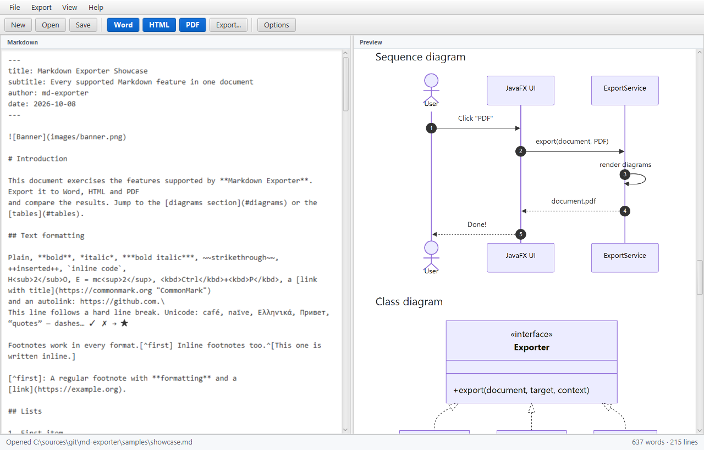
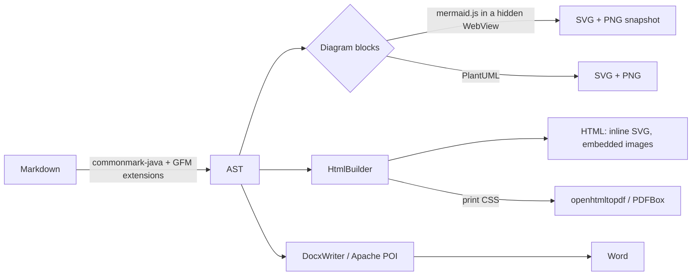

# Markdown Exporter

A JavaFX 21 Markdown editor with live preview (plus a command line mode) that exports Markdown documents to
**Word (.docx)**, **HTML** and **PDF**, including diagrams, tables, images and footnotes. Optional AI features
let Claude, OpenAI, Gemini or a local model suggest changes to a selection or the whole document.



## Features

| Markdown feature                                  | Word | HTML | PDF |
|---------------------------------------------------|:----:|:----:|:---:|
| Headings, emphasis, strikethrough, `++ins++`      |  ✓   |  ✓   |  ✓  |
| Links (external and `#heading` anchors)           |  ✓   |  ✓   |  ✓  |
| Ordered / bullet / nested / task lists            |  ✓   |  ✓   |  ✓  |
| Tables with column alignment                      |  ✓   |  ✓   |  ✓  |
| Images (PNG, JPEG, GIF, BMP, SVG, remote, data:)  |  ✓   |  ✓   |  ✓  |
| Image size `{width=200}`               |  ✓   |  ✓   |  ✓  |
| Code blocks, block quotes, GitHub alerts          |  ✓   |  ✓   |  ✓  |
| Footnotes (`[^1]` and inline `^[...]`)            |  ✓ (real Word footnotes) | ✓ | ✓ |
| **Mermaid** diagrams (` ```mermaid `)             |  ✓   |  ✓ (inline SVG) | ✓ |
| **PlantUML** diagrams (` ```plantuml ` / `puml`)  |  ✓   |  ✓ (inline SVG) | ✓ |
| Graphviz (` ```dot `, needs Graphviz installed)   |  ✓   |  ✓   |  ✓  |
| YAML front matter (`title`, `subtitle`, `author`, `date`) | title block + document properties | ✓ | ✓ |
| Table of contents (option)                        | Word TOC field | ✓ | ✓ with page numbers |
| Simple inline HTML (`<br>`, `<sub>`, `<sup>`, `<kbd>`, ``) | ✓ | ✓ | ✓ |

The application window shows **one tab per document**, each with a Markdown editor and a **live preview**.
Open several files at once (multi-select in *Open…*, drag & drop, or several file names on the command
line); the built-in feature showcase opens in its own tab next to your files (*Help → Feature Showcase*). Opening a file that is already open selects its tab. Tabs can be reordered by
dragging and have a context menu (*Close*, *Close Others*, *Close All*, *Show in Folder*); unsaved tabs ask
before closing. Exports always apply to the selected tab.

| Shortcut | Action |
|---|---|
| `Ctrl+N` / `Ctrl+O` | new document / open files (each in a new tab) |
| `Ctrl+S` / `Ctrl+Shift+S` / `Ctrl+Alt+S` | save / save as / save all |
| `Ctrl+W` / `Ctrl+Shift+W` | close tab / close all tabs |
| `Ctrl+Tab`, `Ctrl+PgDn` / `Ctrl+PgUp` | next / previous tab |
| `Ctrl+Shift+D` / `Ctrl+Shift+H` / `Ctrl+Shift+P` | export to Word / HTML / PDF |
| `Ctrl+E` | export to several formats |
| `F5` | re-render the previews (clears the diagram cache) |
| `Ctrl+Shift+V` | show / hide the preview |
| `Ctrl+,` | settings |

Export options (page size, orientation, margins, table of contents, Mermaid theme, diagram resolution,
embedded or copied HTML images, appearance) and recent files are remembered between sessions.

## Export themes

The **Style** selector in the tool bar (with the pencil button opening the style editor), *Export → Export
Options...*, the *Export Multiple Formats* dialog and *Settings → Export* set the appearance of the exported
documents. It applies to Word, HTML and PDF alike, and to the live preview, which
shows what the export will look like.

| Style | Look |
|---|---|
| GitHub (default) | Segoe UI, GitHub colours, rules under level 1 and 2 headings |
| Classic | Georgia for text and headings, navy links: reports and letters |
| Modern | Segoe UI text, Trebuchet MS headings in the accent colour, no rules |
| Academic | Times New Roman, black headings, Courier New code: papers |
| Minimal | Arial, greys, no rules |
| Dark | light text on a dark page (HTML and PDF; Word documents keep a white page with GitHub colours) |

On top of the style:

* **Accent colour**: links, and the headings of the Modern style.
* **Text, heading and code fonts**: Segoe UI, Arial, Calibri, Verdana, Trebuchet MS, Georgia, Times New Roman,
  Palatino Linotype; code in Consolas or Courier New. PDFs embed the font files; where a font is not
  installed, a font of the same kind (sans-serif, serif, monospaced) is used instead.
* **Text size** in percent of the style's size (all sizes scale, Word styles included).
* **Justify paragraphs**.
* **Custom CSS** (HTML, PDF, preview): a stylesheet applied after the style. The HTML stylesheet exposes CSS
  variables (`--fg`, `--bg`, `--accent`, `--heading`, `--border`, `--font-body`, `--font-heading`,
  `--font-code`, `--font-size`, ...), so `:root { --accent: #b5179e; }` is enough to recolour links. PDF output
  uses openhtmltopdf, which supports CSS 2.1 plus paged media (`@page`), not CSS variables.

The *Mermaid theme* option stays separate: it styles Mermaid diagrams. With the Dark style, diagrams are drawn
on a white panel so that they remain readable.

### Custom styles (export templates)

*Export → Export Styles...* (or *Edit...* next to the style in the export options) opens the style editor:

* every style can be edited: name, description, the nine colours (text, headings, accent, muted text, page
  background, borders, code blocks, inline code, table header), the text / heading / code fonts, lines under
  headings, coloured headings, dark page, and **extra CSS** for HTML, PDF and the preview;
* built-in styles stay unchanged: saving a modified built-in style creates a custom copy;
* *New*, *Duplicate*, *Delete*, *Import...* / *Export...* (`.json` files, to share styles) and *Open Folder*;
* a live preview renders a sample document, or the current document; *Test PDF* and *Test Word* export it to a
  temporary file and open it, since Word cannot use the extra CSS and PDF only understands CSS 2.1;
* **with AI** (when enabled): describe a style ("warm sepia book style with serif headings and a dark red
  accent") or a change to the current one ("bigger, uppercase headings") and the active agent fills in the
  form, extra CSS included. Nothing is saved until you click *Save*; *Revert* drops the suggestion.

*Use This Style* selects the style for the exports. Custom styles are JSON files in a `styles` folder next to
the settings (`~/.md-exporter/styles` for the registry and user file locations, next to the application for
portable settings) and move with the settings. The format:

```json
{
  "name": "Sepia Book",
  "description": "Warm paper tones with serif type",
  "colors": { "text": "#3b2f2f", "muted": "#7a6a5a", "border": "#d8c8b0", "subtle": "#f3ebdd",
              "background": "#fbf6ec", "accent": "#8b1e3f", "heading": "#5a2a1a",
              "codeBackground": "#efe4d0", "tableHeader": "#eadcc4" },
  "fonts": { "text": "Palatino Linotype", "headings": "Georgia", "code": "Courier New" },
  "headingRules": false,
  "coloredHeadings": false,
  "dark": false,
  "css": "h1, h2 { font-variant: small-caps; letter-spacing: .03em; }"
}
```

Missing or invalid values fall back to the GitHub style. On the command line, `--style` accepts the name of a
custom style or the path of such a file.

## Editing

The *Format*, *Insert* and *Table* menus, the formatting tool bar and the editor's context menu offer the usual
editor commands. They work on the selection, or on the word / line at the cursor, and toggle: applying *Bold* to
bold text removes it. Every command is one undo step (`Ctrl+Z`).

| Shortcut | Action |
|---|---|
| `Ctrl+B` / `Ctrl+I` / `Ctrl+U` | bold / italic / underline (`++inserted++`) |
| `Ctrl+Shift+X` / `Ctrl+Shift+C` | strikethrough / inline code |
| `Ctrl+Shift+Space` | clear formatting (emphasis, code, links, simple HTML tags) |
| `Ctrl+1` … `Ctrl+6` / `Ctrl+0` | heading level / normal text |
| `Ctrl+Shift+8` / `7` / `9` | bullet / numbered / task list (converts between list types) |
| `Ctrl+Enter` | tick / untick task items |
| `Ctrl+Shift+Q` | block quote |
| `Ctrl+]` / `Ctrl+[` | indent / outdent (list items nest under the previous item) |
| `Ctrl+K` / `Ctrl+Shift+I` | insert link / image (relative path to the document folder) |
| `Ctrl+T` | insert table |
| `Ctrl+Shift+K` | code block (the *Insert → Code Block* menu adds a language) |
| `Ctrl+Alt+F` | footnote (numbered automatically, definition added at the end) |
| `Ctrl+Shift+F` / `Ctrl+Alt+Shift+F` | format the table at the cursor / all tables (align the columns) |
| `Ctrl+Shift+Enter` | insert a table row below |
| `Ctrl+F` / `Ctrl+H` / `F3` / `Shift+F3` | find / replace (case, whole word, regular expressions) / next / previous |
| `Ctrl+G` | go to line |
| `Ctrl` + mouse wheel, `Ctrl+Num+` / `Ctrl+Num-` | editor zoom |

The tool bar's **¶** button sets heading levels; *More* holds diagrams, alerts, horizontal rules, footnotes and
less common formatting. *Insert* also offers diagram templates (Mermaid flowchart, sequence, class, state, Gantt, pie; PlantUML;
Graphviz), GitHub alerts, horizontal rules, line breaks, front matter and the current date. The *Table* menu
inserts, deletes and moves rows and columns and sets the column alignment.

**Smart editing** (can be turned off in the settings): `Enter` in a list item or quote continues it (`Enter` on an
empty item ends the list); `Tab` / `Shift+Tab` in a table formats it and moves to the next / previous cell
(adding a row after the last one); `Tab` / `Shift+Tab` on a list item or a multi-line selection indents /
outdents.

**Table formatting** pads every cell to the column width (East Asian wide characters count double), writes the
delimiter row to match (`:---`, `:---:`, `---:`), keeps escaped pipes and ignores tables inside code blocks:

```text
Name|Qty|Note             | Name  | Qty | Note  |
:-|-:|:-:          ->     | :---- | --: | :---: |
Apple|3|fresh             | Apple |   3 | fresh |
```

**Preview**: *View → Show Preview* hides the preview (it is then not rendered at all). With *View → Scroll
Preview to Cursor* (on by default) the preview follows the editor: each rendered block knows its source line.
When the editor scrolls, the line in the middle of the editor appears in the middle of the preview; when the
cursor moves, its line appears at the cursor's height. The top and bottom of the editor show the top and
bottom of the preview.

## AI assistant (optional)

Enable it in *Settings → AI*, then add one or more agents; one is active at a time (switch it in *AI → Agent*,
in the tool bar's *AI* button or in the AI dialog).

| Provider | Default endpoint / model | API key |
|---|---|---|
| Anthropic Claude | `https://api.anthropic.com`, `claude-opus-5-5` | `ANTHROPIC_API_KEY` |
| OpenAI | `https://api.openai.com/v1`, `gpt-5` | `OPENAI_API_KEY` |
| Google Gemini | `https://generativelanguage.googleapis.com/v1beta`, `gemini-2.5-flash` | `GEMINI_API_KEY` |
| OpenAI-compatible: Ollama, LM Studio, Mistral, OpenRouter, vLLM... | `http://localhost:11434/v1`, `llama3.2` | optional |

*Load Models* lists the models the service offers, *Test Connection* sends a one-word request. For Claude, the
effort level can be set and declined requests can be re-run on Anthropic's recommended fallback model
(server-side fallback, on by default).

*AI → Ask AI...* (`Ctrl+Shift+A`), the *AI* tool bar button and *Ask AI* in the context menu work on the
selection, or on the whole document when nothing is selected. Ready-made instructions: improve writing, fix
spelling & grammar, shorter, longer, simpler, more formal / casual, translate, format as table, add a Mermaid
diagram, summarize, continue writing, or any instruction of your own. With a selection, the whole document can
be sent along as context (only the selection is changed).

Nothing is applied without review: the answer streams into an editable *Suggestion*; the *Changes* tab shows a
word-level diff where each change can be rejected or accepted again with a click (*Accept All* / *Reject All*).
*Replace* applies the accepted changes, *Insert Below* adds the text after the selection (the default for
summaries and continuations); either is a single undo step.

> [!NOTE]
> The selected text (and the document, when sent as context) goes to the agent's service. API keys entered in
> the settings are stored in plain text in the settings location; leave the key empty to use the environment
> variable instead.

## Settings storage

*Settings → Storage* chooses where preferences (window, export options, editor, AI agents, recent files) are
kept; switching moves all settings and removes them from the old place.

| Location | Where |
|---|---|
| System preferences (default) | Windows registry `HKEY_CURRENT_USER\Software\JavaSoft\Prefs\io\mdexporter\ui` (Java preferences on other systems) |
| Settings file in the user folder | `~/.md-exporter/settings.properties` |
| Portable settings file | `md-exporter.properties` next to `Markdown Exporter.exe` (or the jar), so a copied folder keeps its settings |

At start-up the portable file wins, then the user file, then the registry. `-Dmdx.settings=<file>` forces a
specific file.

## Requirements

* JDK 21 or newer (tested with Temurin 21.0.11)
* Maven 3.9+
* JavaFX **21.0.12** is pulled from Maven Central automatically (the platform specific artifacts are
  selected by the OpenJFX POMs).

No other installation is needed: Mermaid is rendered with `mermaid.min.js` from the
[`org.webjars.npm:mermaid`](https://central.sonatype.com/artifact/org.webjars.npm/mermaid) WebJar inside a hidden
JavaFX `WebView` (upgrade it by changing `mermaid.version` in `pom.xml`), and PlantUML is pure Java (layouts use PlantUML's built-in *Smetana* engine when
Graphviz is not installed). Only ` ```dot ` blocks require a Graphviz installation (`dot` on the `PATH`
or the `GRAPHVIZ_DOT` environment variable).

## Build & run

```bash
mvn javafx:run
```

```bash
mvn clean package
```

`mvn package` runs the tests and produces a self-contained jar for the current platform:

```bash
java -jar target/md-exporter-1.0.0-SNAPSHOT-all.jar
```

### Windows executable

`scripts/build-exe.cmd` (or `scripts/build-exe.ps1`) builds the jar and packages it with the JDK's
`jpackage` and a trimmed Java runtime, so end users need no Java installation. Output goes to `target/dist`.

```bash
scripts/build-exe.cmd
```

| Command | Result | Extra requirement |
|---|---|---|
| `build-exe.cmd` | portable folder `Markdown Exporter\` with `Markdown Exporter.exe` (GUI) and `md-exporter-cli.exe` (console), plus a `.zip` of it | none |
| `build-exe.cmd -Type exe` | setup `.exe`: per-user install (no admin), Start menu + desktop shortcut, `.md` file association | [WiX Toolset 3.x](https://github.com/wixtoolset/wix3/releases) (`winget install WiXToolset.WiXToolset`) |
| `build-exe.cmd -Type msi` | the same as an `.msi` package | WiX Toolset 3.x |
| `build-exe.cmd -Type all` | all of the above | WiX Toolset 3.x |

Options: `-SkipTests`, `-NoBuild` (reuse the existing jar), `-FullRuntime` (bundle every JDK module
instead of the trimmed list, if a feature ever reports a missing class). Installers keep a fixed upgrade code,
so a newer installer replaces the old version.

The version and commit id shown in *Help → About* (and by `--version`) are generated at build time by the
`git-commit-id-maven-plugin` (`-dirty` marks a build with uncommitted changes).

**Why the shade plugin and not Spring Boot's repackager?** Both were measured on this project. A Spring Boot
fat jar (nested jars + its own launcher) works, JavaFX included, but is larger (the 18 MB Mermaid WebJar cannot
be filtered down to `mermaid.min.js`), starts no faster, needs `JarLauncher` as jpackage main class and hides
the nested jars from `jdeps`. Its only advantage, a faster build without class merging, is also offered by a
thin jar + `lib/` folder, which would be the better installer input if shading ever becomes a problem.

### Command line

Any option switches to batch mode (the JavaFX toolkit is still used, invisibly, to render Mermaid):

```bash
java -jar target/md-exporter-1.0.0-SNAPSHOT-all.jar --export -f docx,pdf -o out --toc samples/showcase.md
```

| Option | Description |
|---|---|
| `-x`, `--export` | export the given files |
| `-f`, `--format <list>` | `docx`, `html`, `pdf` (comma separated, default: all) |
| `-o`, `--output <dir>` | output folder (default: next to each input file) |
| `-p`, `--page-size <size>` | `A4` (default), `A5`, `Letter`, `Legal` |
| `--landscape`, `--margin <mm>` | page orientation and margins |
| `--toc` | insert a table of contents |
| `--no-embed` | HTML: copy images to `<name>_files/` instead of embedding them |
| `--theme <name>` | Mermaid diagram theme: `default`, `neutral`, `forest`, `dark`, `base` (see `--style` for the document) |
| `--scale <n>` | diagram/SVG raster resolution for Word and PDF (default `2`) |
| `--style <name>` | `github` (default), `classic`, `modern`, `academic`, `minimal`, `dark`, a custom style name or a style `.json` file |
| `--accent <color>` | accent colour, e.g. `#b5179e` |
| `--font <name>` / `--heading-font <name>` | text / heading font, e.g. `Georgia`, `"Times New Roman"` |
| `--code-font <name>` | `Consolas` or `"Courier New"` |
| `--text-size <percent>` | text size relative to the style (default `100`) |
| `--justify` | justified paragraphs |
| `--css <file>` | HTML/PDF: stylesheet applied after the style |
| `-v`, `--version` | print the version and the commit the build was made from |

Add `-Dmdx.debug=true` to print stack traces on failures.

## How it works



| Package | Content |
|---|---|
| `io.mdexporter.core` | parsing (`MarkdownParser`), options, image loading/rasterisation, `ExportService` |
| `io.mdexporter.diagram` | `DiagramService` (cache + dispatch), `MermaidRenderer`, `PlantUmlRenderer` |
| `io.mdexporter.export` | `HtmlBuilder` (preview/HTML/PDF), `HtmlExporter`, `PdfExporter`, `DocxExporter`/`DocxWriter` |
| `io.mdexporter.editor` | UI independent editing logic: formatting commands, list continuation, table formatter, word diff |
| `io.mdexporter.ai` | AI agents, prompts and streaming clients for Claude, OpenAI(-compatible) and Gemini (`java.net.http` + Jackson) |
| `io.mdexporter.settings` | settings storage: Java preferences (registry) or properties file |
| `io.mdexporter.ui` | JavaFX main window, editor actions, find bar, export / settings / AI dialogs |

Notes:

* Word output uses real Word styles (`Heading 1…6`, `Quote`, `Source Code`, `Table Text`, …), numbering
  definitions and bookmarks, so the navigation pane, TOC and restyling work as usual.
  When a table of contents is requested, Word asks to update fields when the document is opened.
* PDF output embeds system fonts (Segoe UI/Consolas on Windows, DejaVu/Liberation on Linux, Arial/Courier
  on macOS) for proper Unicode support, has PDF bookmarks and page numbers.
* Mermaid uses HTML labels (`foreignObject`), which SVG rasterisers do not support; that is why Word/PDF
  get a high resolution `WebView` snapshot while HTML keeps the vector SVG.
* The self-contained jar bundles the JavaFX natives of the build platform; build it on each target OS.

## Tests

```bash
mvn test
```

The tests export a sample document to all three formats and inspect the results with POI / PDFBox.
They use PlantUML only, so they run headless (Mermaid needs a display for the `WebView`). The editing commands,
the table formatter, the settings stores and the AI clients (against a local fake server for each provider's
streaming protocol, no API key needed) are unit tested.
`samples/showcase.md` exercises every feature and is a good manual test.
